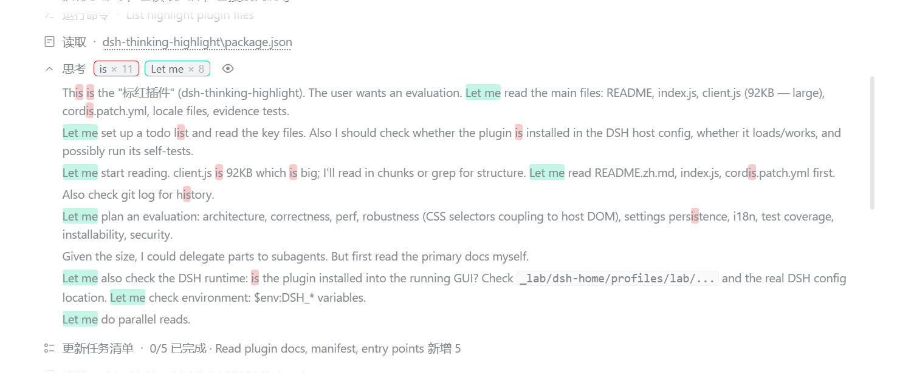
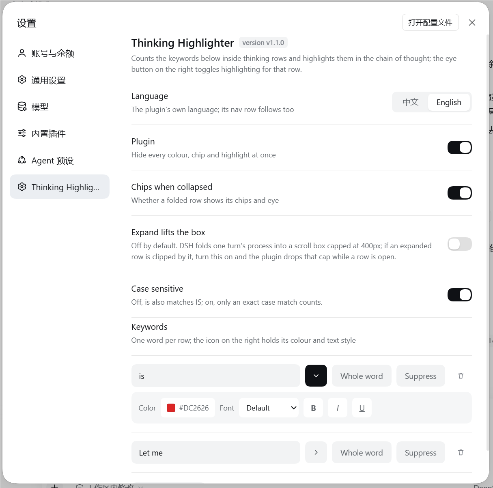

# Thinking Highlighter · 标红插件

A DSH plugin that counts and highlights keywords inside chain-of-thought rows ("thinking" rows), with its own
section in Settings.

[中文说明 →](README.zh.md)



- **Count chips** — every thinking row shows `keyword × n` right after its title, one chip per keyword, so you
  can see at a glance which word keeps coming back and how often.
- **Click a chip to switch that keyword off** — the word stops being highlighted everywhere, the chip stays
  in place in a muted state and the same click turns it back on. The choice is remembered.
- **Highlighting** — expand a row and every occurrence of a keyword is tinted with that keyword's own colour.
- **Per-keyword colour, ink and text style** — the highlight's tint, the words' own text colour (or *Theme*, which
  keeps the host's, so a light/dark flip never leaves a word unreadable), a size on the host's own scale
  (10–22 px, the same range DSH's own content font size uses), typeface (default / monospace / serif), bold,
  italic and underline. What you set is what both the highlight and the chip show, and the chip grows and
  shrinks with its keyword's size.
- **Whole-word matching** — per keyword: `is` either matches everywhere or only where it stands alone
  (never inside `this` or `ThisIs`).
- **Folded rows count the whole chain of thought** — the numbers do not change when you expand a row.
- **Per-row eye** — one row's highlighting can be hidden without touching the others. The marks stay in the
  text while a row is switched off and the stylesheet hides them (tint, text colour, size *and* the keyword's
  own type styling), so switching the eye back on is instant and never leaves another keyword unhighlighted.
- **One row per keyword** — typing a word that already exists is refused, with a note saying why.

## Install

Works on both surfaces — the DSH web UI (`dsh web`) and the desktop app. Pick whichever line matches how you run DSH:

```bash
# dsh web, from npm (installs straight into the `web` profile)
dsh plugin --profile web add @yokira404/dsh-thinking-highlight

# any other profile name
dsh plugin --profile desktop add @yokira404/dsh-thinking-highlight
```

Reload the page (or restart the app) and the settings page is there. In the
[dsh-market](https://github.com/dsh-market/dsh-market) plugin it is the same one-click card.

From a checkout, instead of npm:

```bash
git clone https://github.com/Yokira404/dsh-thinking-highlight.git
cd dsh-thinking-highlight
node evidence/install.mjs desktop        # or another profile name
```

That installer records a `link:` dependency pointing at the checkout, adds the package to
`dsh.profile.bundles`, and creates a junction under `<profile>/node_modules`. Then **restart the app**: the card
appears in **Plugins → 已安装**, where the switch enables or disables it.

`dsh plugin add` does the first two of those itself, for a local folder, a tarball or an npm name alike.

> The dependency entry is not optional: the Plugins page only lists a package the profile records as a
> *dependency* (or as a shipped-optional bundle). A package that is merely selected in `dsh.profile.bundles`
> loads fine but gets no card — and therefore no switch.

### Requirements

- `dsh` with a `web` profile (`dsh web` 0.1.0-rc.6 or newer is what dsh-market itself needs).
- No host packages to install: the plugin imports only `react` and `react-dom/client`, which the host already
  serves to browser halves. It declares no `@deepseek-ai/*` dependency and no `engines` range, so it does not
  constrain which harness build you run.
- The reasoning row it decorates (`[data-variant="think"]`) exists in dsh desktop 0.2.0-rc.2 and in the
  `@deepseek-ai/dsh-client-ui-chat` shipped with `dsh web`; `evidence/host-shape.mjs` asserts the markers it
  depends on are still in the installed bundle.

## Settings

`Ctrl + ,` → **标红插件 / Thinking Highlighter** in the left navigation.



| Row | What it does |
|---|---|
| Language | 中文 / English for the plugin's own UI; the nav row follows it too |
| Plugin | Hides every colour, chip and highlight at once |
| Chips when collapsed | Whether a folded row shows its chips and eye |
| Expand lifts the box (off by default) | DSH folds a turn's process into a scroll box capped at 400px; with this on, an expanded row temporarily drops that cap so a long chain of thought can be read without scrolling inside the box |
| Case sensitive | Off (default): `is` also matches `IS` |
| Keywords | One row per word: text field, `▸ style`, `完整词 / whole word`, suppress, delete |
| ▸ style panel | Tint colour, text colour (**Theme** hands it back to the host), text size (10–22 px stepper), font, **B**old, **I**talic, **U**nderline, and **Badge settings** for that word's chip |
| All badges (in the keyword heading) | Opens the badge editor for the shared chip look every word follows by default |

Settings live in the browser's `localStorage` and apply immediately.

### Badge settings

The chips that carry each word's count are editable on their own: **徽章设置 / Badge settings** at the end of a
word's `▸ style` panel opens the editor for that word's chip, and the button in the keyword heading opens the
same editor for the *shared* badge every word follows. A word leaves the shared look only once something in its
own editor is changed — until then its row says **跟随全局 / Follows the shared badge**, and the shared badge is
what its chips are drawn from.

The dialog is the host's own modal (full-viewport layer, masked backdrop, card on the secondary layer), and it
edits as you go — there is no draft to lose:

| Part | What it does |
|---|---|
| Preview | The row the chip will sit on, drawn with the transcript's own chip builder, so what is previewed is what the row will draw |
| Templates | Six built-in looks (Default, Emphasis, Pill, Outline, Square, Glow) applied in one click, plus **Save as template** for your own — up to 12, each deletable |
| Size | 0.5×–2.4×, by stepper or slider, with **Follow the word's size** on by default so the chip still tracks that word's text size. A chip taller than the line it sits on makes its row grow instead of being clipped |
| Colour | Fill, text and frame, each with a colour well and a way back to the theme — the frame can also keep borrowing the word's own colour |
| Style | Shape (rounded / pill / square), stroke (thin / thick / none), shadow (none / soft / glow) and bold |
| Texture | An image you upload, redrawn to at most 96 px on its long edge and stored in this browser only; tiled, stretched or fitted, with its own strength |
| Reset | Hands the word back to the shared badge (or, from the shared editor, everything back to the default look) — it stays available only while there is something to reset |

## How it works

The thinking row is a sealed built-in component with no slot to render into, so the plugin decorates the
rendered DOM instead — by splitting text nodes, never by replacing them:

- Highlighting empties the text node React owns and inserts the plugin's own spans before it. React keeps
  updating the same node, so streaming never breaks or loses text. The one visible seam: between React writing
  a new chunk into that node and the plugin's next pass (at most one 90 ms coalescing window) the previous
  split and the new text are both in the DOM; the pass drops the stale copy and re-marks the new text.
- Work is coalesced on a 90 ms timer, and a row whose text and settings are unchanged is skipped entirely.
- The chip set is inserted *inside the header's own text line*, after the title and its separator: while a row
  is folded that header is a fixed-height box, so anything appended to the block itself would land below it.
  The header block is found by its `[data-disclosure-row]` line, not by being the row's first element: while
  the model is still streaming the host renders a visually-hidden "running" status span before it, and a chip
  set parked in that 1 px box is a chip set nobody can see.
- The expanded chain of thought is looked for *inside* the disclosure block, right after the header line,
  because that is where `DisclosureRow` renders it (`[div[data-disclosure-row], open && children]`). A settled
  row that was never seen streaming has to be found this way too, or expanding it can never highlight anything.
- Nothing in the chip set may shrink (the collapsed preview beside it is `flex: auto`), which is why the chip
  group has a fixed width cap and clips only itself.
- Counting is text-accurate: the chip set is excluded, the highlight spans are not — otherwise the numbers
  would climb by one on every pass, or collapse to zero after the first highlight.
- The per-row eye is a presentation switch, not a filter on the work: a row keeps its marks while it is
  switched off (`[data-dsh-hl="off"]` neutralises them) so that muting a keyword, streaming or a host
  re-render during that time cannot leave the row with nothing to show when the eye comes back on.
- A keyword that asks for no text colour is marked as `color: currentColor` rather than a fixed hex, so
  "follow the theme" needs no second code path — and the eye-off rule has an inherited value to hand back.
- The chip's size rides a `--dsh-th-chip-scale` factor on the chip element; the stylesheet draws the chip's line
  box at the height the client computed for it (`--dsh-th-chip-line`) — a chip on a collapsed row sits on a header
  line the host pins to a fixed height with `contain: size layout`, where an oversized chip would be clipped
  instead of read. The height the host gives that line is `24px + var(--dsh-content-font-delta)`, and the host
  publishes that delta as a `calc()` over the reader's content font size: a custom property's computed value is
  the token sequence, not the length it stands for, so the plugin derives the number from the size the host sets
  as a plain `<n>px` instead. `host-shape.mjs` asserts that definition is still in the installed bundle — reading
  nothing here is exactly how an oversized chip would go unmeasured.
- Everything the badge editor can set arrives on the chip as a custom property or a data attribute, and every one
  of them falls back to the rule that drew the chip before the editor existed — a chip nobody customised carries
  no paint of its own, so the default look is still the host's tokens and nothing else. The text a chip draws
  when it stands alone (a dimmer token) survives a customisation that does not touch the ink, because only the
  fields that were actually given a value are written.
- A chip scaled past the line it sits on asks its row for the room it needs: the plugin raises the collapsed
  row's own height and its disclosure line by exactly what the tallest chip on it requires, and puts both back
  the moment nothing needs them (`setRoom` / `sweepRooms`, the same give-and-take as the fold lift). The row is
  raised only while it is folded — an expanded row's height is its own content's — so a scaled-up badge is a size
  rather than a crop.
- The badge editor is the host's own dialog, spelled with the tokens its Modal primitive uses, and it is mounted
  inside the settings page rather than portalled: the layer is `position: fixed`, so it covers the viewport from
  where the plugin already is, and the row it edits is named by id rather than by position — a row deleted while
  its editor is open closes the editor instead of handing it to whichever row slid into that place.
- A texture is an uploaded image redrawn to at most 96 px on its long edge, kept as a data URL beside the other
  settings and drawn by a pseudo-element inside the chip, under its text. Nothing remote is ever stored or
  requested, and a stored record that names a network address is dropped on the way in.
- A folded row has no body to read: the host only mounts the chain of thought while expanded, and the whole
  text lives in the host component's `text` prop. The plugin reaches it through the fiber React attaches to
  every element it created (`__reactFiber$…`); anything unexpected reads as "unavailable" and the DOM text is
  used instead.

## Compatibility and caveats

- The plugin decorates `[data-variant="think"]` rows as DSH renders them today. A DSH release that changes
  those internals can require an update here; when a lookup fails the plugin degrades to doing less, never to
  breaking the transcript. `evidence/host-shape.mjs` models the installed markup and also asserts the markers
  it depends on are still present in the app's own bundle, so a DSH rename fails a test instead of going quiet.
- The 10–22 px size range is not the plugin's own: it is the host theme plugin's content font size
  (`min(10).max(22).default(14)`). The plugin cannot read the host's schema at runtime, so `host-shape.mjs`
  asserts those two numbers are still in that bundle — a DSH release that changes the range fails a test first.
- Per-keyword suppression applies to **all rows** (the chip is the same keyword everywhere). The per-row eye is
  the per-row control.
- *Expand lifts the box* and a badge scaled past its line are the two settings that reach into host layout. The
  badge one is unavoidable — a larger chip cannot be drawn inside a fixed-height line — so it is granted
  automatically, only while a chip needs it, and given back with the row's own height the moment it does not.
- Settings live in this browser's `localStorage`. A change made in another window arrives through the browser's
  `storage` event; the plugin re-reads the store and rebuilds every row. A texture lives there too, which is why
  an upload is redrawn small first and refused rather than stored if it is still too large.

## Development

```bash
node evidence/selftest.mjs         #  71 checks: splitting, undoing, counting, case, colour, size, whole-word edges
node evidence/client-harness.mjs   # 177 checks: the browser half really runs, against a stubbed host
node evidence/css-check.mjs        #  31 checks: the stylesheet literal (braces, chip/row/panel/editor rules)
node evidence/locale-check.mjs     #  11 checks: package meta, both locale files and the version tag agree
node evidence/host-shape.mjs       #  30 checks: the installed row markup, plus its markers in the app bundle
node evidence/e2e-bundle.mjs <page-url-with-token> @yokira404/dsh-thinking-highlight <cookie>
```

The self-tests extract the shipped functions out of `client.js` by brace matching and run them against a DOM
stub — never a copy — and the harness executes the factory, `apply`, the settings page and a full row
decoration with React stubbed out. They exist because the failure modes here are quiet ones: a template
literal that loses its tail, counts that count themselves, a cache that keeps a highlight from coming back.

`host-shape.mjs` is the one suite that models the DOM the host actually renders — the hidden status span, the
body nested inside the disclosure block — because a fixture built from the plugin's own assumptions cannot
catch a wrong assumption. It skips its bundle check with a printed SKIP when the app is not installed here.

`e2e-bundle.mjs` checks a running scratch profile end to end: the host row activates, the boot graph carries
the browser half, and the served bundle is byte-identical (sha256) to `client.js`.

| File | Role |
|---|---|
| `package.json` | bundle manifest: `dsh.bundle.patch` + `dsh.client` (`platform: web`) |
| `cordis.patch.yml` | inserts the `thinking-highlight` row into a profile |
| `index.js` | host half; makes the package loadable and publishes `dsh.client` |
| `client.js` | browser half: the settings section and the reasoning-row decoration |
| `locale/*.json` | card title and description, in the `{"meta": {...}}` shape DSH reads |
| `icon.svg` | plugin icon |
| `docs/` | the screenshots used above |

At runtime, `window.__DSH_TH__` exposes `settings()`, `rows()` (`{ highlighted, count, hasBadges, marked,
folded }`), `refresh()`, `clear()`, `pass()`, `passes()` and `diagnose()` for poking at the decoration from the
console.

`diagnose()` covers the case where the plugin has clearly loaded — its settings page is there — and yet no chips
appear. It switches on a page-state probe and answers the one question the other seams cannot: does the plugin
see any reasoning row on this page at all? It returns the current counts; reload, and every pass then writes
what it found to `localStorage['dsh-thinking-highlight.state.probe']` — the stored settings, the last pass's row
and keyword counts, and a per-row record (count, chips present, marks still in the document, folded, expanded).
It is off by default because it writes on every pass; `diagnose(false)` turns it back off.

## Uninstall

Use the card's **卸载 / Remove** in the Plugins page, or delete the `link:` dependency, the
`node_modules/@yokira404/dsh-thinking-highlight` junction and the `dsh.profile.bundles` entry by hand. Unloading
removes every chip, puts the split text nodes back, drops the plugin's stylesheet and takes its `dsh-th-body`
marker class off the host's elements.

## License

[MIT](LICENSE) © 2026 Yokira404
